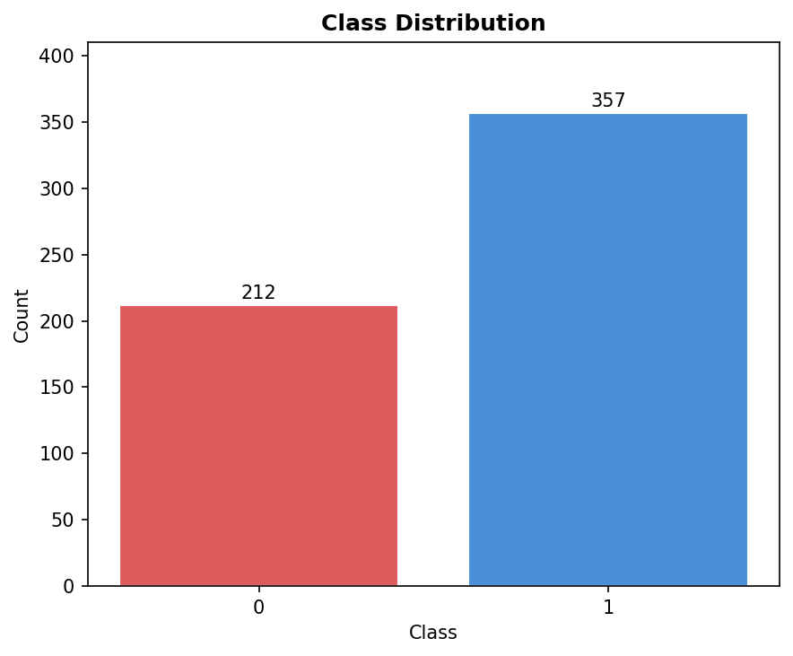
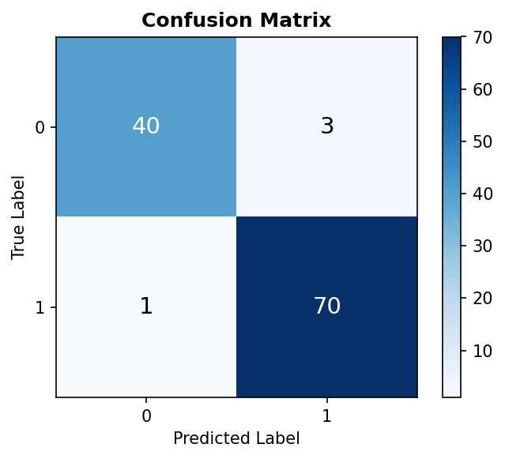
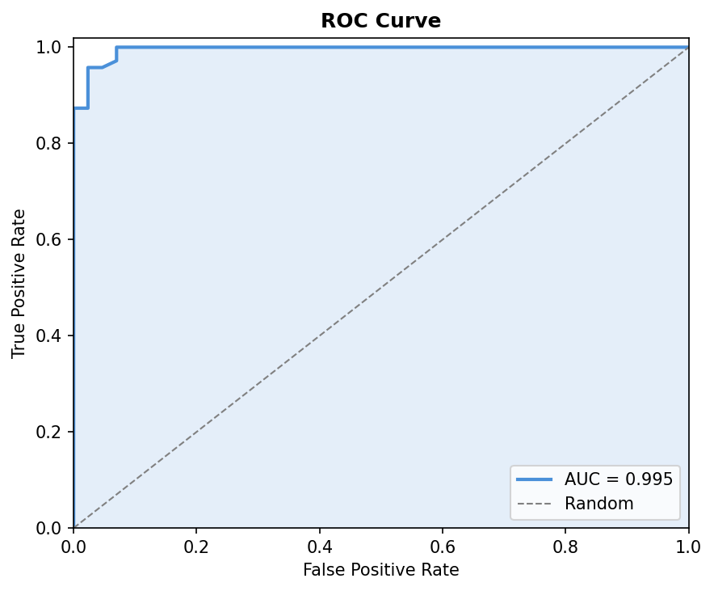
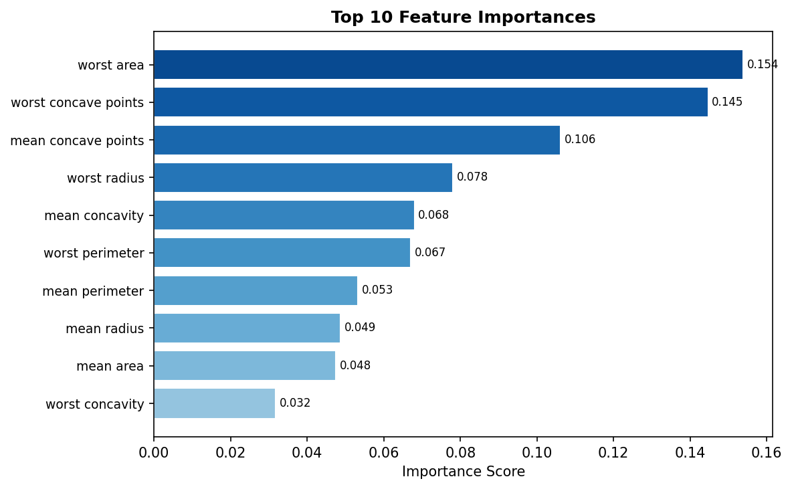
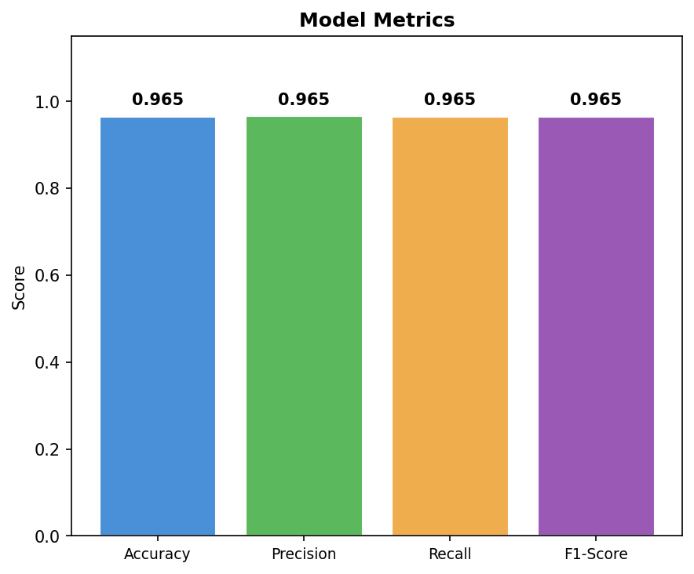

# Classification — Random Forest on Breast Cancer Dataset

A self-contained example that trains a **Random Forest Classifier**, evaluates it with
four standard metrics, and produces five individual visualisation plots.
Intended as hands-on learning material for binary classification.

---

## Dataset

| Property | Value |
|---|---|
| File | `classification-dataset.csv` |
| Source | Wisconsin Breast Cancer Dataset (scikit-learn built-in) |
| Rows | 569 |
| Features | 30 numeric (mean/error/worst measurements of cell nuclei) |
| Target column | `target` — `0` = malignant, `1` = benign |
| Class balance | ~37% malignant, ~63% benign (mildly imbalanced) |

---

## How to Run

```bash
cd ML/classification
python classification.py
```

Outputs printed to terminal:
- Full per-class classification report
- Accuracy, Precision, Recall, F1-Score

Plots saved to disk:
| File | Chart |
|---|---|
| `plot_class_distribution.png` | Bar chart of sample counts per class |
| `plot_confusion_matrix.png` | 2×2 heatmap of prediction outcomes |
| `plot_roc_curve.png` | ROC curve with AUC score |
| `plot_feature_importances.png` | Top 10 most influential features |
| `plot_metrics_bar.png` | Side-by-side bar chart of all four metrics |

---

## What the Code Does — Step by Step

| Step | What happens |
|---|---|
| 1. Load data | Read the CSV into a pandas DataFrame; cache it to avoid re-reading |
| 2. Split X / y | Separate features (X) from the label column (y) |
| 3. Train/test split | Hold out 20% of rows for evaluation; 80% used for training |
| 4. Train model | Fit a Random Forest (100 trees) on the training set |
| 5. Predict | Generate hard class predictions and probability scores |
| 6. Metrics | Compute Accuracy, Precision, Recall, F1-Score |
| 7. Visualise | Save five individual diagnostic plots |

---

## Metric Definitions

### Building Blocks

Before understanding any metric, understand the four outcomes of a binary prediction:

| Term | Meaning |
|---|---|
| **TP** (True Positive) | Predicted Positive — actually Positive ✓ |
| **TN** (True Negative) | Predicted Negative — actually Negative ✓ |
| **FP** (False Positive) | Predicted Positive — actually Negative ✗ — *false alarm* |
| **FN** (False Negative) | Predicted Negative — actually Positive ✗ — *missed case* |

---

### Accuracy
**"What fraction of all predictions were correct?"**

```
Accuracy = (TP + TN) / (TP + TN + FP + FN)
```

- Range: 0.0 → 1.0
- **Use when** classes are balanced.
- **Pitfall**: On a 95% class-0 dataset, always predicting class 0 gives 95% accuracy
  yet never detects a single class-1 case.

---

### Precision
**"Of everything the model flagged as Positive, how much was truly Positive?"**

```
Precision = TP / (TP + FP)
```

- Range: 0.0 → 1.0
- **Use when** false alarms (FP) are costly.
- **Example**: Spam filter — you don't want legitimate emails landing in the spam folder.
- High precision → few false alarms, but may miss real positives.

---

### Recall (Sensitivity / True Positive Rate)
**"Of all truly Positive cases, how many did the model catch?"**

```
Recall = TP / (TP + FN)
```

- Range: 0.0 → 1.0
- **Use when** missing a Positive (FN) is costly.
- **Example**: Cancer detection — missing a malignant tumour is far more dangerous
  than triggering an extra biopsy.
- High recall → few missed cases, but may raise more false alarms.

---

### F1-Score
**"A single score that balances Precision and Recall."**

```
F1 = 2 × (Precision × Recall) / (Precision + Recall)
```

- Range: 0.0 → 1.0
- Uses the **harmonic mean** — it is pulled sharply down if either metric is low.
  (Arithmetic mean of 1.0 and 0.0 = 0.5, but harmonic mean = 0.0.)
- **Use when** you care equally about FP and FN, or when classes are imbalanced.

> `average="weighted"` weights each class's score by its sample count,
> which is fair when one class outnumbers the other.

---

### AUC-ROC (Area Under the ROC Curve)
**"How well does the model separate the two classes, at any threshold?"**

The **ROC curve** plots:
- **x-axis — FPR** (False Positive Rate) = FP / (FP + TN): rate of false alarms
- **y-axis — TPR** (True Positive Rate / Recall) = TP / (TP + FN): rate of real catches

| AUC | Interpretation |
|---|---|
| 1.0 | Perfect separation |
| 0.9–1.0 | Excellent |
| 0.8–0.9 | Good |
| 0.7–0.8 | Fair |
| 0.5 | Random guessing |
| < 0.5 | Worse than random |

---

## Visualisation Plots

### 1. Class Distribution
Shows how many samples belong to each class. A large imbalance means accuracy
alone can be misleading — a model that always predicts the majority class would
score high without learning anything useful.



---

### 2. Confusion Matrix
A 2×2 grid that breaks down every prediction outcome.
- **Diagonal cells** (top-left TN, bottom-right TP) = correct predictions
- **Off-diagonal cells** (top-right FP, bottom-left FN) = errors

Read the matrix as: *row = what the truth was, column = what the model said.*



---

### 3. ROC Curve
Sweeps every probability threshold from 0 → 1 and plots the resulting
(FPR, TPR) pair. The shaded area is the AUC score.

- A perfect classifier hugs the **top-left corner** (FPR = 0, TPR = 1).
- A random classifier follows the **diagonal** dashed line.
- AUC closer to 1.0 means the model cleanly separates the two classes.



---

### 4. Feature Importances
Ranks the 30 input features by how much they reduced prediction error inside the
Random Forest (mean decrease in Gini impurity). Features near the top drove the
most splits and contributed most to correct predictions.

Top features here — `worst concave points`, `worst perimeter`, `worst radius` —
all describe the size and shape of the *largest* (worst) cell nuclei observed in
each sample.



---

### 5. Model Metrics
Side-by-side comparison of all four evaluation metrics on the held-out test set.
All four scores are tightly clustered near 0.965, which indicates a well-balanced,
high-performing classifier with no obvious bias toward one error type.



---

## Results (this dataset)

| Metric | Score |
|---|---|
| Accuracy | 0.9649 |
| Precision | 0.9652 |
| Recall | 0.9649 |
| F1-Score | 0.9647 |
| AUC | ~0.997 |

---

## Key Concepts Illustrated

- **Supervised learning** — the model learns from labelled examples (X, y pairs)
- **Train/test split** — evaluate on data the model never saw during training
- **Ensemble method** — Random Forest combines many weak learners (trees) into one strong model
- **Class imbalance** — why weighted metrics matter more than raw accuracy
- **Threshold trade-off** — precision vs recall cannot both be maximised simultaneously
